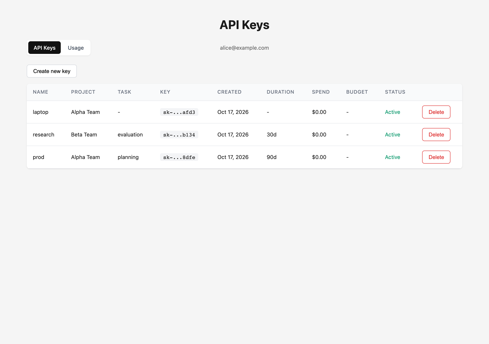
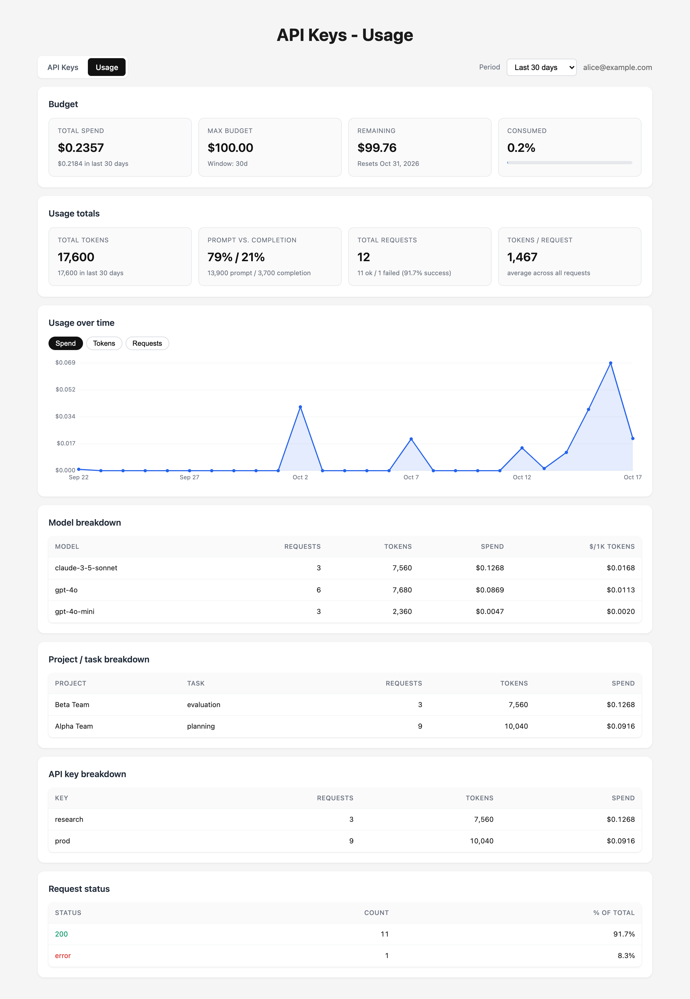
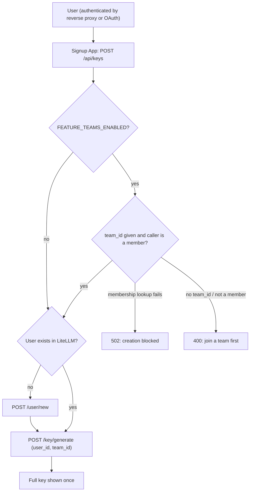
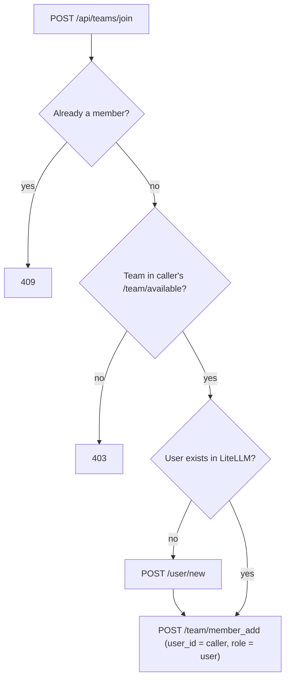

# Signup App

API key management UI backed by LiteLLM proxy. Authenticated users can create, view, and delete API keys, and inspect their spend, token usage, and budget posture against a project/task hierarchy.



## Usage Dashboard

Per-user accounting view: budget cards, lifetime/current-period totals,
daily time series, model and API-key breakdowns, and a Project/Task
drill-down by the keys' teams (or `project` metadata) and tasks. See
[docs/2026-05-07-usage-dashboard.md](docs/2026-05-07-usage-dashboard.md)
for the full schema and tag conventions.



## Tech Stack

- **Backend:** FastAPI (Python 3.11+)
- **Frontend:** Plain HTML/CSS/JS (no build step)
- **Key Storage:** LiteLLM proxy (admin API)
- **Auth:** Reverse proxy header injection (production), debug bypass (development)

## Quick Start

```bash
# Start mock LiteLLM server
uv run uvicorn mocks.litellm_mock:app --port 4000 &

# Setup
cp .env.example .env
# Set LITELLM_ADMIN_KEY=sk-mock-admin-key in .env

uv sync --extra dev
uv run uvicorn app.main:app --reload --port 8000
```

Open http://localhost:8000 to access the key management UI.

## Docker

```bash
cp .env.example .env
docker compose up --build
```

### Released images

Each release is published as a container image on the GitHub Container
Registry and attached to its [GitHub Release](https://github.com/garland3/signup-app/releases):

```bash
docker pull ghcr.io/garland3/signup-app:0.2.0   # or :latest
cp .env.example .env   # set LITELLM_BASE_URL, LITELLM_ADMIN_KEY, PROXY_SECRET
docker run -p 8000:8000 --env-file .env ghcr.io/garland3/signup-app:0.2.0
```

Without registry access, download `signup-app-<version>-linux-amd64.tar.gz`
and its `.sha256` from the release, then:

```bash
sha256sum -c signup-app-0.2.0-linux-amd64.tar.gz.sha256
docker load -i signup-app-0.2.0-linux-amd64.tar.gz
```

To build the image yourself from a checkout: `docker build -t signup-app .`
(or `podman build`), then run it as above with `signup-app` as the image. On
an Apple Silicon Mac, add `--platform linux/amd64` to build for x86-64 Linux
servers.

### Corporate proxies and internal CAs

**Building behind a TLS-inspecting proxy.** If the build fails with
`CERTIFICATE_VERIFY_FAILED` while installing packages, pass your corporate CA
(PEM) as a build secret:

```bash
docker build --secret id=corp_ca,src=$HOME/corp-ca.pem -t signup-app .
```

The CA is added to the builder's trusted certificates for the dependency
install step only. Because it is mounted as a secret, it is not stored in any
image layer. Without `--secret` the build is unchanged.

**Calling internal HTTPS services at runtime.** If LiteLLM or your identity
provider uses a certificate from an internal CA, mount a bundle and point
`SSL_CERT_FILE` at it:

```bash
cat /etc/ssl/cert.pem $HOME/corp-ca.pem > $HOME/corp-bundle.pem   # public roots + corporate CA
docker run -p 8000:8000 --env-file .env \
  -v $HOME/corp-bundle.pem:/certs/bundle.pem:ro -e SSL_CERT_FILE=/certs/bundle.pem \
  signup-app
```

`SSL_CERT_FILE` replaces the default trust store, so include the public roots
as shown if the app also calls public HTTPS sites.

### Cutting a release

1. Set `version` in `pyproject.toml` and merge to `main`.
2. Tag the merge commit and push the tag:
   `git tag v<version> && git push origin v<version>`.

`.github/workflows/release.yml` then builds the image, checks that it starts
(`/api/health`), scans it with Trivy (report attached to the release), pushes
`ghcr.io/garland3/signup-app:<version>` and `:latest`, and creates the GitHub
Release with the image tarball and checksum. The tag must match
`pyproject.toml`. To rebuild an existing tag, run the workflow manually
(Actions > Release > Run workflow).

## How It Works

The app is a thin UI layer over LiteLLM's key management API:

```
User -> Reverse Proxy -> Signup App -> LiteLLM Proxy
```

The app holds a single admin key (`LITELLM_ADMIN_KEY`) to manage keys on behalf of users. Users are scoped by email via LiteLLM's `user_id` field.

### Key names

Every key the app makes is named `<user>-<name>` in LiteLLM (its alias), so
names are unique across users. The keys table and the Usage page show the
`<name>` part only; set `HIDE_KEY_NAME_PREFIX=false` to show the full alias. The
API's `name` is the full alias either way, with the shown name in
`display_name`. Keys made outside the app, whose names don't start with the
prefix, are shown as they are.

### Hidden keys

Other tools may make keys for a user that the user has no use for, such as a
gateway's short-lived session keys. Marking such a key `"hidden": true` in its
metadata (the JSON boolean) leaves it out of the app:

- it isn't listed, and doesn't count toward `MAX_ACTIVE_KEYS_PER_USER`;
- it can't be changed, blocked or deleted through the app (404, as for
  someone else's key);
- its usage still counts on the Usage page, in one "Other keys" row with
  other tools' keys.

`hidden` is reserved, like `deleted_at`: users' metadata can't set it, and
`REQUIRED_KEY_METADATA` can't ask for it.

## Keys, projects and models

Users can make as many keys as they need: one per project, or several in a
project, for example one per model. There is no key-count limit unless
`MAX_ACTIVE_KEYS_PER_USER` is set. That cap counts a user's active keys across
all projects together, so leave it blank (the default) unless you want an
overall ceiling. Key creation is still rate limited
(`RATE_LIMIT_KEY_CREATE_PER_HOUR`).

When creating a key, users pick its models from the ones its project allows:
"All models in this project" (the default) or any subset. The keys table shows
each key's models, or "All". A project's models come from its LiteLLM team's
`models` list:

- empty, or containing `all-proxy-models`: every model on the proxy;
- `["no-default-models"]`: none, until an administrator sets the list;
- otherwise: the listed models.

Without teams, every model on the proxy is offered. The server checks the
models on create and update (`PATCH /api/keys/{token}`), so a key can't be
given a model its project doesn't allow. A requested model must be one the
project (or, without teams, the proxy) lists, or match one of its wildcards:
a team list with `openai/*` allows `openai/gpt-4o`. This is stricter than
LiteLLM on purpose: an access-group name that isn't in the list is refused
(400), even if LiteLLM would expand it. Under group overage (`TEAM_SOURCE=claims`),
`GET /api/models` is refused with the same 403 as key creation. A request may
name at most 100 models, each at most 256 characters (422 beyond that).
With teams on, the models of a key without a team (made before teams) can't
be changed (400).

**Upgrading:** `models` on `POST /api/keys` and `PATCH /api/keys/{token}` was
passed to LiteLLM unchecked before. It is now checked, so existing automation
that sends access-group names, aliases or models outside the key's team gets
a 400. Send names from `GET /api/models` instead, or add them to the team's
`models` list. See
[docs/2026-10-22-keys-per-project-and-models.md](docs/2026-10-22-keys-per-project-and-models.md).

## Key lifetimes (`MAX_KEY_DURATION`)

`MAX_KEY_DURATION` (e.g. `90d`; units `s`, `m`, `h`, `d`, `mo`) caps the duration a key
made or changed through the app may be given. Leave it blank for no limit.

- **A key with no duration** gets the maximum. Without a maximum, it never
  expires.
- **A longer duration is refused** (400), when a key is made (`POST /api/keys`)
  and when its duration is changed (`PATCH /api/keys/{token}`).
- **A month is 30 days** (a behavior change: before, `mo` went to LiteLLM as
  is, a calendar month, on every deployment, with or without a maximum). LiteLLM itself reads `mo` as calendar months (28 to 31
  days, depending on the date), so the app sends LiteLLM months as days (`3mo`
  as `90d`): a key lasts exactly the duration that was checked. `MAX_KEY_DURATION`
  in months counts the same way (`3mo` is 90 days). The keys list shows the
  duration as it was entered.
- **It caps each period, not a key's total life.** Changing a key's duration
  (`PATCH`) starts a new period from that moment, as LiteLLM does, so an owner
  can renew a key, each time for at most the maximum.
- **Deleting a key** (the Delete button, `DELETE /api/keys/{token}`) expires it at
  once and marks it deleted (`deleted_at` in its metadata, which only the app
  writes: users' metadata can't set it, or `duration`); it stays in the list as
  Inactive. A deleted key can't be changed or renewed (400). Blocking is not final: the owner can unblock their key through
  the API (`POST /api/keys/{token}/unblock`), even one an administrator blocked in
  LiteLLM, so an administrator who must end a key for good deletes it in LiteLLM.
- **The Create API Key dialog** shows the maximum under the duration field, says
  what an empty field means, and checks the duration before sending it. The
  server's check is the one that counts.
- **Not retroactive:** keys made before the limit was set, or outside the app
  (LiteLLM's admin UI or API), keep their expiry, including none. To bound them
  too, set an expiry on them in LiteLLM, or delete them.

## Authentication

Two modes, selected via `AUTH_MODE` in `.env`:

### `AUTH_MODE=proxy` (default)

The app sits behind a reverse proxy that injects an `X-User-Email` header. In
development, set `DEBUG_MODE=true` to fall back to `TEST_USER`. Optionally set
`FEATURE_PROXY_SECRET_ENABLED=true` + `PROXY_SECRET=...` to require a shared
secret header from the proxy.

### `AUTH_MODE=oauth`

The app runs a standard OAuth 2.0 / OIDC authorization code flow. Configure:

```
AUTH_MODE=oauth
OAUTH_CLIENT_ID=...
OAUTH_CLIENT_SECRET=...
OAUTH_AUTHORIZE_URL=...
OAUTH_TOKEN_URL=...
OAUTH_USERINFO_URL=...
OAUTH_SCOPES=openid email profile
OAUTH_REDIRECT_URL=http://localhost:8000/api/auth/callback
OAUTH_EMAIL_FIELD=email
SESSION_SECRET=<random secret>
```

Unauthenticated users hit `GET /api/auth/login` to start the flow; the callback
lands on `GET /api/auth/callback`, which sets a signed session cookie. Log out
with `GET /api/auth/logout`. See `.env.example` for Google/GitHub examples.

#### Claims from the ID token (OpenID Connect)

By default the user's email comes from the userinfo endpoint. With an OpenID
Connect provider (Keycloak, Microsoft Entra ID, ...) the app can take its
claims from the ID token instead, verified against the provider's signing keys:

```
OAUTH_CLAIMS_SOURCE=id_token
OAUTH_ISSUER=https://keycloak.example.com/realms/myrealm
# Optional: where to fetch the signing keys, if not the address discovery names
# (e.g. an in-cluster URL); discovery is <OAUTH_ISSUER>/.well-known/openid-configuration
OAUTH_JWKS_URL=
```

The app sends a `nonce` with the sign-in request and checks the ID token's
signature (asymmetric algorithms only), issuer, audience (`OAUTH_CLIENT_ID`),
expiry and nonce. `OAUTH_USERINFO_URL` isn't needed then. This is the way to use
Entra ID, whose userinfo endpoint (Microsoft Graph) returns few claims and a
`sub` that differs per application.

#### The LiteLLM user ID

Users are keyed in LiteLLM by their email (`user_id` = email). To key them by a
stable identifier instead, name the claim:

```
OAUTH_USER_ID_FIELD=sub     # Keycloak; Entra ID: oid (with OAUTH_CLAIMS_SOURCE=id_token)
```

LiteLLM users are then created with that ID and the email as their
`user_email`; key aliases still start with the email. Existing users and keys
stay under their email IDs: switching a deployment that already has users moves
them to new LiteLLM users.

A user the app creates is named in LiteLLM's admin UI (its `user_alias`) by the
username claim, `OAUTH_USERNAME_FIELD` (default `preferred_username`), else by
the email. That matters when LiteLLM won't give the new user its email, which
it keeps unique: when the account was recreated (a new ID, the same email), the
alias is all that tells who the user is. Existing users keep their alias.

#### Logging out

Log out ends the app's session, then sends the browser to the provider's logout
endpoint (OpenID Connect RP-initiated logout) with the sign-in's ID token as
`id_token_hint`, so the provider ends its session without asking. Without that,
the provider's single sign-on would sign the person straight back in. The
person is then signed out of other applications that share that provider
session too.

- **The endpoint:** `OAUTH_LOGOUT_URL`, else the `end_session_endpoint` that
  discovery names (with `OAUTH_ISSUER`). Set it when the app can't reach the
  provider's public address, as with `OAUTH_JWKS_URL`, and when the provider
  serves logout from another host than its issuer (Amazon Cognito, a custom
  domain): the app then logs a warning and ends its own session only, since the
  browser would block the redirect (below). With neither, Log out ends the
  app's session only.
- **Back to the app:** the provider then sends the browser to
  `OAUTH_POST_LOGOUT_REDIRECT_URL`, by default the app's page on
  `OAUTH_REDIRECT_URL`'s host. Register it with the provider as a post-logout
  redirect URI (Keycloak: the client's "Valid post logout redirect URIs")
  **before upgrading**: a provider that doesn't know it refuses the logout
  (Keycloak: 400, "Invalid redirect uri") and shows an error page instead.
- **The page's policy:** browsers apply the Content-Security-Policy's
  `form-action` to a form's redirects too, so it allows the logout endpoint's
  origin (`OAUTH_LOGOUT_URL`'s, else `OAUTH_ISSUER`'s) next to `'self'`.

#### Running behind a TLS-terminating proxy (Kubernetes)

By default the session cookie is marked `Secure` and only sent over HTTPS. If
TLS is terminated upstream (e.g. a Kubernetes ingress or load balancer) and the
app only sees plain HTTP traffic internally, set:

```
SESSION_COOKIE_SECURE=false
```

The cookie will still be signed and `HttpOnly`; the browser just won't require
HTTPS on the hop between itself and your ingress. Make sure the external URL
(the one users hit, and `OAUTH_REDIRECT_URL`) is still HTTPS.

## Running under a URL path prefix

If the app sits behind a reverse proxy that maps a sub-path (for example
`https://mydomain.com/start` -> this container), set `ROOT_PATH` in the
environment:

```
ROOT_PATH=/start
```

All routes, static assets, and OAuth redirects are then served beneath the
prefix. Visiting the container root (`/`) issues a 307 redirect to the
prefix. When using OAuth, make sure `OAUTH_REDIRECT_URL` also includes the
prefix (e.g. `https://mydomain.com/start/api/auth/callback`).

## LiteLLM Teams (optional)

Teams support is **disabled by default**. Enable it with:

```
FEATURE_TEAMS_ENABLED=true
```

When enabled, users can join LiteLLM teams themselves, and **every new API
key must belong to a team the user is a member of**. Teams act as an
authorization and budget boundary, so read the deployment notes below before
turning this on.

> **Warning:** enabling teams before users are assigned to teams (or before
> any teams are offered for self-join) leaves those users unable to create
> API keys. Follow the rollout procedure below.

Deployments whose teams stand for something with its own name (projects, cost
centers) can set `TEAM_LABEL=Project`: the UI and messages then say project
instead of team. `TEAM_LABEL_PLURAL` gives a plural that isn't the label plus
"s" (`Classes`, `Facilities`). The label is used as written, so
`TEAM_LABEL=project` shows "project" in headings too. Within sentences the label is lower case, unless it has
capitals past its first letter (`SIG`). The API keeps `team_id` and
`/api/teams`. With teams, the Usage page's "Project / task breakdown" groups
keys by their team. A deployment whose project means something else (a charge
code) lists `project` in `REQUIRED_KEY_METADATA`: people enter it, and the
breakdown groups by that instead. `TEAM_LABEL=Project` then gives "project" two
meanings, so choose a different label there.

### Requirements

- A LiteLLM proxy exposing `GET /team/list`, `GET /team/available`,
  `POST /team/member_add`, and `POST /key/generate` with `team_id`. The
  feature was built against the LiteLLM API spec bundled in this repo
  (`litellmopenapi.json`, LiteLLM 1.80.10); verify the behavior of your
  deployed version, especially `/team/available` (see below).
- `LITELLM_ADMIN_KEY` must be a proxy-admin key: `/team/member_add` is
  restricted to proxy admins and team admins.
- Teams must already exist in LiteLLM. This app never creates or deletes
  teams.

### User workflow

- **Join a team:** a "Join a team" button appears when LiteLLM offers teams
  the user can join and isn't already in. The user picks one and is added
  with role `user`. If the user doesn't exist in LiteLLM yet, it is created
  first.
- **Create a key:**
  - In **one** team: the key is scoped to that team automatically; no
    selector is shown.
  - In **several** teams: a Team dropdown in the Create API Key dialog picks
    which team the key belongs to.
  - In **no** team: key creation is blocked with "Join a team before
    creating a key."





### Authorization and failure behavior

While teams are enabled:

- `POST /api/keys` requires a `team_id` for a team the caller belongs to.
  A missing `team_id` or a team the caller isn't in is rejected with 400
  before anything is created in LiteLLM.
- If the team membership lookup fails, key creation is blocked (502). It
  never falls back to a key without a team.
- `GET /api/me` stays available during a lookup failure but reports
  `teams_unavailable: true`, and the UI shows an error instead of treating
  the user as having no teams.
- Self-join always acts on the caller's own identity (never an email from
  the request), only for teams in the caller's `/team/available` list, and
  always with role `user`, so a user cannot add other people, join
  arbitrary teams, or make themselves a team admin.

### Deployment security: `/team/available` is the enrollment allowlist

The join endpoint trusts LiteLLM's `/team/available` response to decide
which teams a user may join, then uses the admin key to add them. **Any team
LiteLLM returns there can be joined by any authenticated user.** If a
restricted team appears in that list, users can enroll themselves into it.

Before enabling teams, check what your LiteLLM returns for an ordinary user:

```bash
curl -s -H "Authorization: Bearer $LITELLM_ADMIN_KEY" \
  "$LITELLM_BASE_URL/team/available?user_id=someone@example.com"
```

Make sure only teams intended for self-service enrollment appear, and adjust
your LiteLLM configuration if restricted teams show up (see your LiteLLM
version's documentation for how available teams are configured). The mock
server in this repo offers **every** team to every non-member, so it cannot
catch an overbroad configuration.

### Rollout procedure

1. Create the teams in LiteLLM.
2. Assign existing users to their teams in LiteLLM, and/or configure which
   teams are offered for self-join.
3. Verify `/team/available` as shown above, for at least one ordinary user.
4. Set `FEATURE_TEAMS_ENABLED=true` and restart the app.

### Teams from the identity provider (`TEAM_SOURCE=claims`)

Instead of LiteLLM memberships and self-join, team membership can come from the
identity provider, so it is governed there (group administration, Entra ID
access packages, reviews) and the app only ever reads it:

```
AUTH_MODE=oauth
FEATURE_TEAMS_ENABLED=true
TEAM_SOURCE=claims
GROUPS_FIELD=groups          # the claim holding the groups; Entra ID app roles: roles
TEAM_GROUP_PREFIX=project-   # only these groups are teams
TEAM_CLAIMS_MAX_AGE_SECONDS=0  # without a refresh token: trust sign-in groups this long (min. 60 s)
OAUTH_SCOPES=openid email profile offline_access  # Entra ID: offline_access, for a refresh token
```

- **A person's teams** are the groups in their sign-in claims that start with
  `TEAM_GROUP_PREFIX` and name a LiteLLM team, by `team_alias` or `team_id`
  (group `project-alpha` -> the team aliased `project-alpha`). Operators create
  the teams; groups without a team are ignored. A name that could mean two
  teams (an alias two teams share, or one team's alias and another's ID) means
  neither, and is logged, so a team admin who renames their team can't take
  another team's group members, though the clash blocks that group until it's
  resolved. Keep changes to aliases with the prefix to proxy administrators.
- **Names without the prefix:** `HIDE_TEAM_NAME_PREFIX=true` shows team names
  without `TEAM_GROUP_PREFIX` (`project-alpha` as `alpha`): in the keys table,
  the team pickers and the Usage page's project/task breakdown. Display only:
  the API, LiteLLM and the groups keep the full names. A name without the
  prefix is shown as it is. It applies only here, with teams from the identity
  provider, whose groups all have the prefix: teams people join in LiteLLM
  (`TEAM_SOURCE=litellm`) can have any name, and without the prefix `project-x`
  and `x` would look the same. `/api/config` gives the prefix the page leaves
  off as `team_name_prefix`, and the breakdown's rows the shown name as
  `display_project`.
- **Only administrators may create groups with the team prefix, or add people
  to them.** A group named like a team makes its members members of that team,
  with its models and budget. Some providers let people create groups
  themselves or join open ones (Entra ID: Microsoft 365 groups, unless
  restricted); restrict that for the prefix, or use Entra ID app roles, which
  only administrators assign. A group naming no team gives nothing.
- **No self-join:** `/api/teams/available` and `/api/teams/join` answer 404 and
  the Join button stays hidden. `GET /api/me` reports `team_source: "claims"`.
- **Before a key is made, changed or unblocked** the app refreshes the person's
  tokens (refresh-token grant) and re-reads their groups, so someone taken out
  of a group can't make or widen keys in it from an old session. Changes and
  unblocks therefore share key creation's hourly cap
  (`RATE_LIMIT_KEY_CREATE_PER_HOUR`), in their own count. Anything uncertain
  fails closed:
  - the provider refuses the refresh (the sign-in session ended, the person was
    disabled, the refresh token was revoked): the app's session ends (401), and
    the person signs in again;
  - the refreshed token is for someone else: the session ends (401);
  - the refreshed token has no groups claim: the person has no teams, so no key;
  - the token left the groups out because there are too many (Entra ID's
    "groups overage": `_claim_names`, or `hasgroups`): refused (403), and
    `/api/me` reports the teams as unavailable rather than empty. Send fewer
    groups (Entra ID: "Groups assigned to the application", or app roles);
  - **no refresh token** (the provider issued none; Entra ID issues one only with
    the `offline_access` scope, so add it to `OAUTH_SCOPES`): groups from a
    sign-in in the last 60 seconds are used, as fresh as a refresh would give.
    Older ones need a new sign-in (401, which the page turns into one), after
    which the key can be made. A sign-in that returns no refresh token also
    drops any earlier sign-in's. A deployment that can't get refresh tokens can
    set `TEAM_CLAIMS_MAX_AGE_SECONDS` to accept the groups from sign-in for
    longer: someone removed from a group can then still make keys in it for
    that long.
- **LiteLLM membership follows:** before making the key the app checks whether
  the person is a member of the team (`GET /team/list?user_id=`), and adds them
  (`/team/member_add`, role `user`) if not, so the team's per-member budget
  applies. A failed add is checked again, in case a concurrent request added
  them.
- Use it with `OAUTH_CLAIMS_SOURCE=id_token` for groups in the ID token (Keycloak:
  a group membership mapper on the client; Entra ID: app roles), or with
  userinfo if the provider puts the groups there.
- **Someone sees "You aren't in any project"?** Each sign-in logs a
  `team_claims_sign_in` line with the groups the provider sent (`received`)
  and those that start with the prefix (`kept`):
  `kubectl logs deploy/<app> | grep team_claims_sign_in`. No claim (`null`)
  means the provider sends no groups (Keycloak: add a Group Membership mapper
  to the client). `/project-alpha` means a group path (turn off "Full group
  path"). Hex IDs mean group IDs, not names. A kept group must also be a
  LiteLLM team's `team_alias` or `team_id`, exactly once.

#### Required: a reconciler for people who leave

The app reads groups only when someone uses it, so it can't notice that a person
has left a group, or the organization. **It doesn't remove LiteLLM team members
or revoke keys.** Requests go straight to LiteLLM with the key, so without
something else, a person who leaves a group keeps their keys in that team until
the keys expire, if they expire at all (a key made without a duration never
does), and stays a member of the LiteLLM team. The app itself refuses them new
keys in that team, and changes or unblocking of their keys there (both re-read
their groups first); they can still block or delete those keys.

A deployment using `TEAM_SOURCE=claims` must therefore run a reconciler beside
the app, which periodically, for each team:

1. reads the identity provider's current members of the team's group;
2. removes LiteLLM team members who are no longer in it
   (`POST /team/member_delete` with `team_id` and `user_id`). LiteLLM then
   deletes that member's keys in the team itself, so they stop working at once;
3. for people disabled or deleted in the identity provider, deletes all their
   keys.

The reconciler must match people by the same user ID the app uses
(`OAUTH_USER_ID_FIELD`), and should change nothing when the directory can't be
read or a group is missing, so an outage or a renamed group doesn't remove
everyone. Examples: a SCIM bridge driven by the identity provider's
provisioning (the design in PR #42), or a job reading the identity provider's
admin API (the platform this app was first deployed with runs one in its key
broker). The integration tests below check step 2's behavior against a real
LiteLLM.

## API Endpoints

| Method | Path | Auth | Description |
|--------|------|------|-------------|
| GET | `/api/health` | No | Health check |
| GET | `/api/me` | Yes | Current user email and `team_source`. With teams enabled, also `teams` (`[{team_id, team_alias}]`) and `teams_unavailable` (bool) |
| GET | `/api/keys` | Yes | List keys (masked) |
| POST | `/api/keys` | Yes | Create key (full key returned once). With teams enabled, `team_id` is required and must be one of the caller's teams. Optional `models` must be a subset of the team's models (empty: all of them) |
| GET | `/api/models` | Yes | Models a new key may use: `?team_id=` (one of the caller's teams) with teams enabled, the proxy's models otherwise |
| PATCH | `/api/keys/{token}` | Yes | Update key settings |
| DELETE | `/api/keys/{token}` | Yes | Delete key |
| GET | `/api/dashboard` | Yes | Aggregated usage/spend payload |
| GET | `/api/teams/available` | Yes | Teams the caller may join (teams enabled only; 404 otherwise) |
| POST | `/api/teams/join` | Yes | Add the caller to a team, body `{"team_id": "..."}` (teams enabled only; 404 otherwise) |

## Mock LiteLLM Server

For development without a real LiteLLM instance, use the included mock:

```bash
uv run uvicorn mocks.litellm_mock:app --port 4000
```

Admin key: `sk-mock-admin-key`

Like LiteLLM, the mock pages `/key/list`: 10 keys a page unless asked for more
(at most 100), newest first. The app reads every page.

The mock also implements the team endpoints and seeds two empty teams
(`team-alpha`, `team-beta`), all offered for self-join, which is useful
for trying the teams feature locally but not representative of a real
deployment.

## Tests

```bash
uv run --extra dev pytest tests/ -v
```

Integration tests against a real LiteLLM (team membership, repeated adds, team
lookup, and `/team/member_delete` deleting the member's keys) run when a proxy
is given; otherwise they're skipped. Use a staging proxy: they create and delete
throwaway `probe-<uuid>` teams and users with the admin key.

```bash
LITELLM_INTEGRATION_URL=http://localhost:4000 LITELLM_INTEGRATION_KEY=sk-... \
  uv run --extra dev pytest tests/test_litellm_integration.py -v
```
