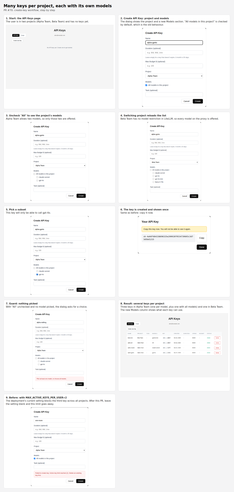

# Many keys per project, with per-key models (2026-10-22)

## Problem

Users need several keys in one project, for example one key per model they
use, and some projects need just one. Today two things get in the way:

- **A per-user cap of 2.** The deployment sets `MAX_ACTIVE_KEYS_PER_USER=2`.
  That cap counts all of a user's active keys across every project, so a user
  in two projects gets one key each.
- **No way to choose a key's models.** The API accepts a `models` list per key,
  but the Create API Key dialog has no model picker. Every key can use every
  model its project allows, and nothing shows which models those are.

## Decisions

1. **No key-count limit by default.** No new cap is added. The deployment
   change is to leave `MAX_ACTIVE_KEYS_PER_USER` blank (no limit); the code
   already treats blank as "no limit". The hourly creation rate limit
   (`RATE_LIMIT_KEY_CREATE_PER_HOUR`) still applies.
2. **Users pick a key's models from its project.** The create dialog lists the
   models the chosen project allows. The user keeps "All models in this
   project" (the default) or picks a subset.
3. **Projects and models are visible.** The create dialog always shows the
   project, and the keys table gets a Models column ("All" for a key with no
   model restriction).

## Design

### Which models a project allows

From the LiteLLM team's `models` list:

| Team `models`                          | Models offered                       |
|----------------------------------------|--------------------------------------|
| empty, or contains `all-proxy-models`  | every model on the proxy (`GET /v1/models`) |
| `["no-default-models"]`                | none (an admin hasn't set the models yet) |
| a list of names                        | those names (`no-default-models` dropped) |

Without teams (`FEATURE_TEAMS_ENABLED=false`), every model on the proxy is
offered. The proxy's model list is cached for 60 seconds.

### API

- **New** `GET /api/models?team_id=<id>` returns `{"team_id", "models": [...]}`
  for one of the caller's teams. With teams on, `team_id` is required, and a
  team the caller isn't in is rejected (400). With teams off, the parameter
  is ignored and the proxy's models are returned. With `TEAM_SOURCE=claims`,
  membership comes from the sign-in's groups, as for `/api/me`; under group
  overage the request is refused with the same 403 as key creation. The
  picker and the create/update checks share one lookup (`models_for`), so
  they can't disagree.
- **`POST /api/keys`** accepts `models` as before. Each requested model must be
  in the team's allowed list, or match one of its wildcards (`openai/*` allows
  `openai/gpt-4o`), or the request fails with 400 before anything is created.
  This is deliberately stricter than LiteLLM: an access-group name that isn't
  in the list is refused, and so is a blank model name (so `[""]` can't mean
  "all"). If the team or the proxy's model list can't be read, or `/team/info`
  has no `team_info.models` list, the request fails (400 for a missing team,
  502 otherwise) and nothing is created. An empty or missing `models` means "all of the project's models":
  no list is sent, and the key inherits the team's access.
- **`PATCH /api/keys/{token}`** applies the same check when `models` is
  changed, against the key's own team, so a key can't be widened beyond its
  project.

### UI

- **Create dialog:** a Models section under the project picker, with the
  checkbox "All models in this {project}" (checked by default). Unchecking it
  shows one checkbox per allowed model. The list reloads when the project
  changes. Picking no models with "All" unchecked is refused with a message.
- **Keys table:** a Models column showing a key's models, or "All".

### Code layout

- `app/core/model_access.py` (new): the allowed-models rules, the proxy-model
  cache, and request validation.
- `app/routes/models.py` (new): `GET /api/models`.
- `app/core/litellm_client.py`: `list_models()` (`GET /v1/models`) and
  `get_team()` (`GET /team/info`). A team's models are always read from
  `/team/info` after the membership check, for both team sources, so
  `/api/me` keeps its shape.
- `app/routes/keys.py`: model checks in create and update.
- `static/`: the Models section and column.
- `mocks/litellm_mock.py`: `GET /v1/models`, and seeded team model lists.

## Workflow

Screenshots from the mock LiteLLM (`mocks/litellm_mock.py`): Alpha Team allows
two models, and Beta Team has no model list, so it offers every proxy model.

| Step | Screenshot |
|---|---|
| Models section, "All" by default | [02-dialog-default.png](images/keys-per-project/02-dialog-default.png) |
| The project's models | [03-pick-models.png](images/keys-per-project/03-pick-models.png) |
| Another project, another list | [04-switch-project.png](images/keys-per-project/04-switch-project.png) |
| Nothing picked is refused | [07-nothing-picked.png](images/keys-per-project/07-nothing-picked.png) |
| Several keys per project, Models column | [08-keys-table.png](images/keys-per-project/08-keys-table.png) |
| Before: `MAX_ACTIVE_KEYS_PER_USER=2` | [09-old-limit.png](images/keys-per-project/09-old-limit.png) |
| A project with no models yet (`no-default-models`) | [10-no-models.png](images/keys-per-project/10-no-models.png) |
| The model list couldn't be loaded | [11-load-failed.png](images/keys-per-project/11-load-failed.png) |

Steps 10 and 11 answer `/api/models` in the browser (Playwright route
interception) to show those two states; the rest is the running app.

## Rollout

1. Merge and deploy.
2. In the deployment's settings, change `MAX_ACTIVE_KEYS_PER_USER=2` to
   `MAX_ACTIVE_KEYS_PER_USER=` (blank), then restart the app.
3. Make sure each project's LiteLLM team has the right `models` list: that is
   what users can pick from.

## Out of scope

- Changing an existing key's models from the UI (the API supports it).
- Model access groups shown as their member models (a group name appears
  as one entry).
