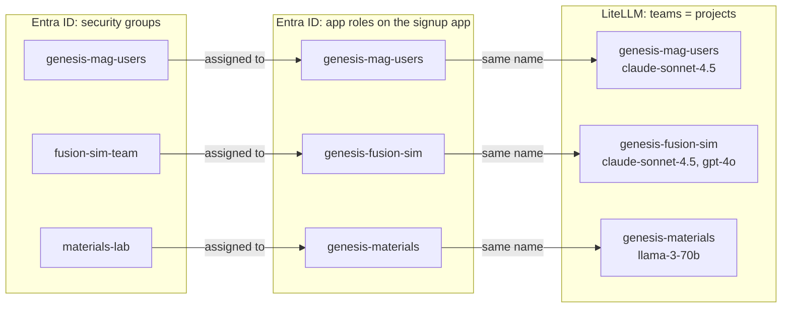
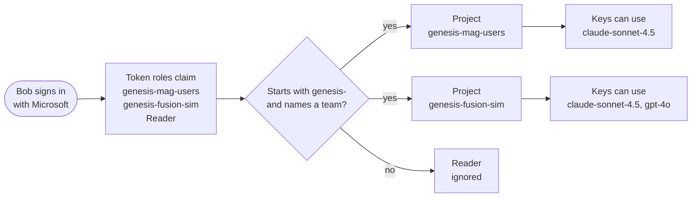

# Option A: one Entra ID app role per project (2026-10-28)

Each project is an **app role** on the signup app's Entra ID registration,
assigned to that project's security group. People's sign-in token then lists
the role **names** they hold (the `roles` claim), and every name that matches
a LiteLLM team becomes a project they can create keys in. No code change.

See also: [multiple security groups and projects](2026-10-28-multiple-groups-and-projects.md).

## How a project is wired



Example projects: only `genesis-mag-users` exists today. The security group's
own name can be anything; the app role's **value** is what must start with
`genesis-` and equal the LiteLLM team's `team_alias`.

| Who | How often | What |
|---|---|---|
| Entra admin | per project | Create one app role (value `genesis-<project>`) and assign the project's security group to it |
| LiteLLM admin | per project | Create one team with `team_alias` = the role value, and the project's models |
| Signup app | once | `GROUPS_FIELD=roles`, `TEAM_GROUP_PREFIX=genesis-`; no redeploy for new projects |

## Someone in two groups signs in

Example: Bob is in `genesis-mag-users` and `fusion-sim-team`, and also holds an
unrelated role, `Reader`.



In Create API Key, Bob gets a Project dropdown with both projects, and each
key is limited to the models of the project he picked.

## Examples

| Person | Security groups | Roles in the token | Sees in Create API Key |
|---|---|---|---|
| Alice | genesis-mag-users | `genesis-mag-users` | 1 project, picked automatically |
| Bob | genesis-mag-users, fusion-sim-team | `genesis-mag-users`, `genesis-fusion-sim`, `Reader` | 2 projects in a dropdown |
| Carol | materials-lab, 300 other groups | `genesis-materials` | 1 project (roles aren't capped) |
| Dana | none of the project groups | no `genesis-` roles | "You aren't in any project" |

Carol shows why roles help: with the plain `groups` claim, Entra leaves all
groups out of the token for people in more than about 200 groups. Only roles
assigned on this app appear in the `roles` claim.

## Set it up

1. **Signup app, once**:
   ```yaml
   - name: GROUPS_FIELD
     value: "roles"
   - name: TEAM_GROUP_PREFIX
     value: "genesis-"
   - name: OAUTH_CLAIMS_SOURCE
     value: "id_token"        # roles are in the ID token, not userinfo
   ```
2. **Entra ID, per project**: App registrations, signup app, **App roles**,
   Create app role. Allowed member types: Users/Groups. Value:
   `genesis-<project>`.
3. **Entra ID, per project**: Enterprise applications, signup app, **Users and
   groups**, Add user/group: pick the project's security group and the role.
4. **LiteLLM, per project**, once:
   ```bash
   curl -s -X POST "$LITELLM_BASE_URL/team/new" \
     -H "Authorization: Bearer $LITELLM_ADMIN_KEY" -H "Content-Type: application/json" \
     -d '{"team_alias": "genesis-fusion-sim", "models": ["claude-sonnet-4.5", "gpt-4o"]}'
   ```
   Two teams with the same name match nothing.
5. **People** sign out and back in. The project appears in Create API Key.

## Notes

- The existing `genesis-mag-users` team (object ID as `team_id`,
  `genesis-mag-users` as its name) matches by name under option A, so it needs
  no change.
- Assigning a group to an enterprise application needs Entra ID P1 or P2.
- Sign-in must work with `OAUTH_CLAIMS_SOURCE=id_token` first.
